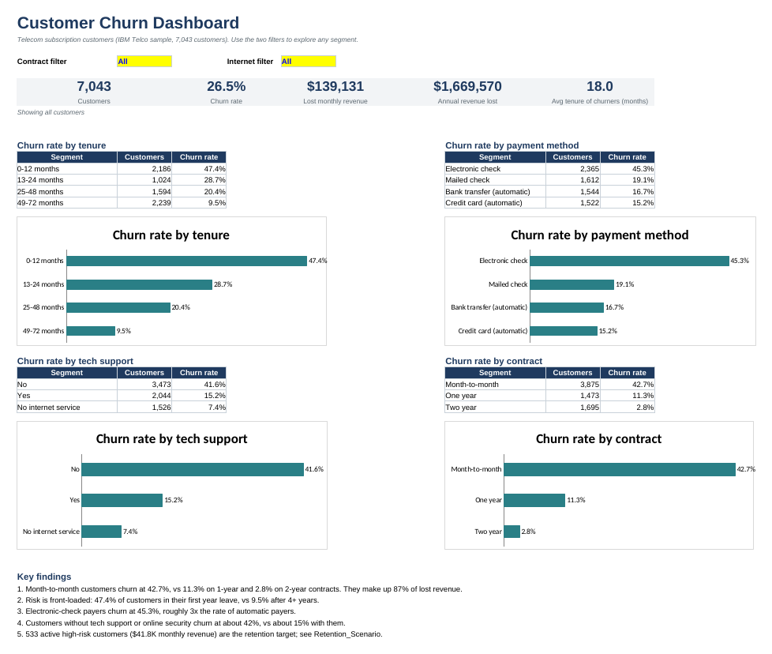
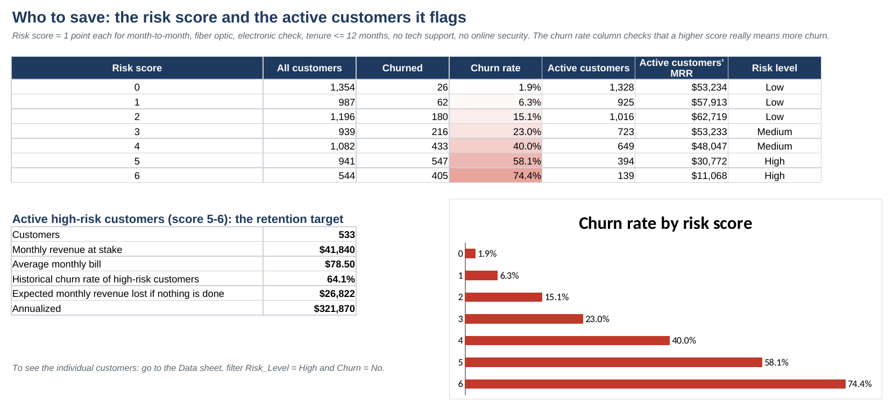
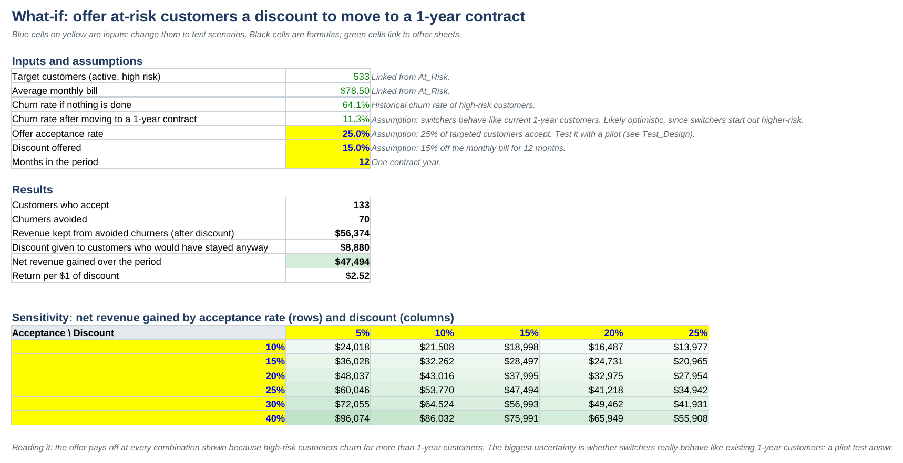

# Customer Churn and Revenue-at-Risk Analysis

**A telecom company loses 1 in 4 customers, costing $1.67M a year. One customer profile drives 49% of that loss, and a simple risk score finds 533 customers worth saving.** Built in Excel and SQL, with the business documents a stakeholder would actually receive.



## Business problem
A subscription telecom company offers phone and internet plans on monthly, 1-year and 2-year contracts. 26.5% of customers left in the latest period. The retention team needs to know who is leaving, why, how much revenue is at risk, and where to spend its budget. Full brief: [problem statement](business_docs/01_problem_statement.md).

## Key results
| Metric | Value |
| --- | --- |
| Customers | 7,043 |
| Churn rate | 26.5% (1,869 customers) |
| Monthly revenue lost | $139,131 (30.5% of all monthly revenue) |
| Annual revenue lost | $1.67M |
| Riskiest profile's share of lost revenue | 49% (month-to-month + fiber + electronic check) |
| Active high-risk customers to target | 533 ($41.8K monthly revenue) |
| Modelled net gain from a retention offer | about $47K in year 1 |

## Findings
1. **Contract type is the strongest driver.** Month-to-month customers churn at 42.7% vs 2.8% on 2-year contracts, and make up 87% of lost revenue.
2. **The first year is the danger zone.** 47.4% of first-year customers leave, vs 9.5% after four years.
3. **Electronic-check payers churn at 45.3%,** about 3x the rate of automatic payers.
4. **Add-ons build loyalty.** Internet customers with no add-on services churn at 52%; with all six, 5%.
5. **Every driver is statistically significant** (chi-square p < 0.001, calculated in Excel with CHITEST).
6. **A 0-6 risk score works:** churn rises from 1.9% at score 0 to 74.4% at score 6.



## Recommendations
1. **Pilot a discounted 1-year contract offer** for the 533 active high-risk customers.
2. **Move electronic-check payers to auto-pay** with a small one-time credit.
3. **Run a first-90-days onboarding programme,** since nearly half of first-year customers leave.
4. **Bundle tech support or online security** with new fiber plans.
5. **Review fiber pricing and service quality.**

Details, owners and risks: [findings and recommendations memo](business_docs/03_findings_and_recommendations.md).

## What-if model
The Excel model estimates the return of the retention offer and shows how it changes with acceptance rate and discount. Every input is editable.



Before any rollout, the offer should be tested. The [pilot design](business_docs/04_retention_pilot_design.md) sizes the test at 379 customers per group, more than the 533 high-risk customers available, so the pilot is widened to medium-risk customers.

## What's in the Excel workbook
| Sheet | What it does | Excel skills |
| --- | --- | --- |
| Dashboard | KPI cards and 4 charts; dropdown filters for contract and internet type update everything | COUNTIFS, SUMIFS, AVERAGEIFS with wildcard filters, data validation, charts |
| README | How to use the workbook, data cleaning log, definitions | Documentation |
| Analysis | Churn rate, revenue, share of lost revenue and lift for 10 customer dimensions | COUNTIFS, SUMIFS, IFERROR, conditional formatting |
| Stats_Tests | Chi-square test for each driver | CHITEST, expected-frequency tables |
| Risk_Segments | 36 contract x internet x payment profiles, ranked | Multi-criteria COUNTIFS, RANK |
| At_Risk | Risk score validation and the retention target | Helper columns, nested IF |
| Retention_Scenario | What-if model with a sensitivity table | Input/formula separation, scenario analysis |
| Test_Design | Sample size for a pilot test | NORMSINV, statistical power |
| Data | 7,043 customers plus 8 calculated helper columns | Data cleaning formulas, filters |

All 57,000+ numbers are live formulas: change a filter or an input and the workbook recalculates.

## SQL
`sql/01_churn_analysis.sql` repeats the key analysis in 11 queries: data quality checks, KPIs, churn by segment, lift with window functions, top risk profiles with RANK, the risk score, and a prioritised retention call list with ROW_NUMBER. The results match the Excel workbook exactly.

## Business documents
| Document | Purpose |
| --- | --- |
| [Problem statement](business_docs/01_problem_statement.md) | Background, stakeholders, questions, scope, deliverables |
| [KPI definitions](business_docs/02_kpi_definitions.md) | One agreed definition for every metric |
| [Findings and recommendations](business_docs/03_findings_and_recommendations.md) | One-page memo for the Head of Retention |
| [Retention pilot design](business_docs/04_retention_pilot_design.md) | Hypothesis, metrics, sample size and decision rule |

## How to use
**Excel:** download `excel/Customer_Churn_Analysis.xlsx` and open the Dashboard sheet. Change the yellow filter cells. Works in Excel 2010 or later.

**SQL (free, no installation of a database server needed):**
1. Install [DB Browser for SQLite](https://sqlitebrowser.org/).
2. Create a new database, open the **Execute SQL** tab and run `sql/00_create_table.sql`.
3. File > Import > Table from CSV file > choose `data/telco_customer_churn.csv`, tick "Column names in first line", name the table `customers`, and choose to add the rows to the existing table.
4. Run the queries in `sql/01_churn_analysis.sql` one at a time.

The queries also run in MySQL 8+ and PostgreSQL.

## Repository structure
```
customer-churn-analysis/
├── data/              telco_customer_churn.csv + data dictionary
├── excel/             Customer_Churn_Analysis.xlsx (dashboard, analysis, models)
├── sql/               00_create_table.sql, 01_churn_analysis.sql
├── business_docs/     problem statement, KPI definitions, memo, pilot design
└── images/            screenshots used in this README
```

## Limitations
- One snapshot in time; no history of price changes, complaints or network quality.
- Patterns show association, not proven cause. The pilot test is how cause would be proven.
- Modelled savings assume customers who switch contracts behave like existing 1-year customers, which is likely optimistic.

## Data source
[IBM Telco Customer Churn sample dataset](https://github.com/IBM/telco-customer-churn-on-icp4d) (Apache 2.0). Fictional customers; amounts in US dollars.

## Author
**Pratiti Toppo**, B.Tech, NIT Jamshedpur. Data analyst with experience in e-commerce analytics (Eternz) and manufacturing quality data (AM/NS).
[LinkedIn](https://www.linkedin.com/in/YOUR-LINKEDIN) · pratititoppo6@gmail.com
